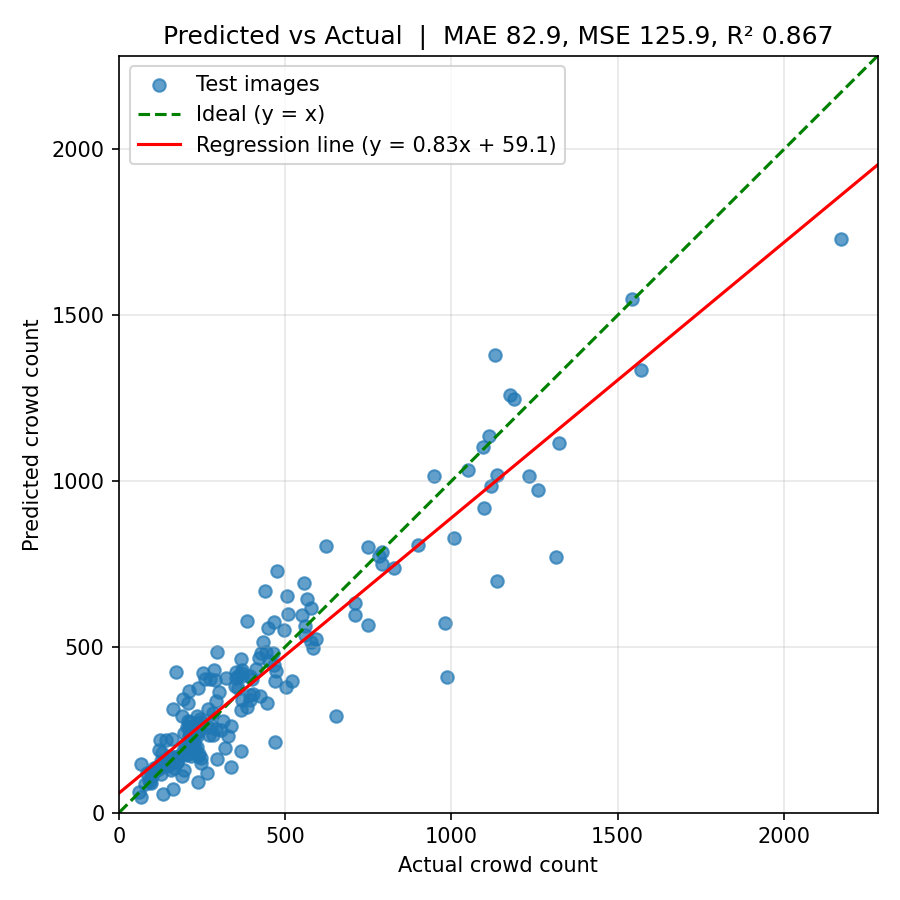

# A CNN-Based Density-Map Regression Approach to Crowd Density Estimation

**Subject:** Deep Learning & Computer Vision
**Student:** Gonepalli Likitha (23ME1A5420)
**Guide:** Mr. E. Surendra Babu

## Abstract
This project proposes a CNN-based density-map regression model to estimate crowd counts from surveillance footage, addressing crowd density estimation through a data-driven approach. The pipeline uses public crowd datasets, applies suitable pre-processing before training, and tests the model on held-out data. The project culminates in a venue crowd-safety dashboard, bridging the gap between the underlying model and everyday use.

**Keywords:** crowd, density, estimation, CNN, density map, regression

## How it works
1. Head annotations are converted into Gaussian **density maps** (the map sums to the person count).
2. **CSRNet** (VGG-16 front-end + dilated-convolution back-end) regresses the density map from the image.
3. The estimated count is `density_map.sum()`.
4. A **Streamlit dashboard** shows the count, density heatmap and a SAFE / WARNING / DANGER alert against a venue capacity.

## Project structure
```
├── app.py            Streamlit dashboard
├── model.py          CSRNet model
├── dataset.py        Data loading + density-map generation
├── train.py          Training script
├── evaluate.py       MAE / MSE evaluation
├── utils.py          Model loading, prediction, safety rule
├── requirements.txt
└── weights/model.pth Trained weights (add after training)
```

## Dataset
Download ShanghaiTech (Part A / B) and place it like this:
```
data/part_A/train_data/images, data/part_A/train_data/ground-truth
data/part_A/test_data/images,  data/part_A/test_data/ground-truth
```

## Setup and usage
```bash
pip install -r requirements.txt

# Train
python train.py --train_root data/part_A/train_data --val_root data/part_A/test_data --epochs 100

# Evaluate
python evaluate.py --test_root data/part_A/test_data --weights weights/model.pth

# Run dashboard
streamlit run app.py
```

## Results
| Dataset | MAE | MSE | R² |
|---|---|---|---|
| ShanghaiTech Part A | 85.38 | 122.87 | 0.873 |



## Live demo
_https://crowd-density-estimation-cnn-erfselzgfmhfpaveudwdbn.streamlit.app/Add your Streamlit Cloud link here after deploying._
